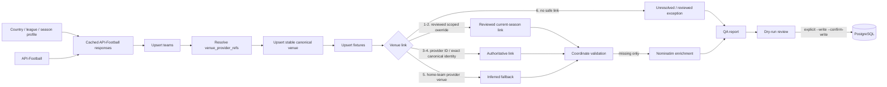

# Data ingestion playbook

This is the canonical import guide. `ingest_leagues.py` is the main API-Football entry point and is read-only unless both `--write` and `--confirm-write` are supplied.

## Flow



## Configuration and safety

### Weekly season readiness (manual, read-only)

Run from the repository root with the existing credentials configured, once a
week during normal operator review:

```powershell
.\.venv\Scripts\python.exe -m ingestion.season_readiness --max-requests 13 --output reports/ingestion/season-readiness.json
```

This writes only local JSON/text reports. PostgreSQL transactions are explicitly
read-only; no imports, canonical allocation, activation or scheduling occurs.
`SEASON_READINESS_WATCHLIST` is separate from ingestion profiles and active
discovery scopes. The initial watchlist contains only the six approved USA men's
competitions. Reuse existing explicit-ID European profiles with, for example,
`--profile europe-approved-2026`; the same total request cap applies, so a larger
profile can return an incomplete report requiring another bounded operator run.
Profiles containing unresolved/name-only IDs are rejected rather than guessed.

The report always bypasses provider caches and checks response counts/pagination.
An unavailable next season normally costs one country-metadata request; six
new seasons with fixtures/rosters cost up to 13 requests. Additional advertised
keys consume the same capped budget. Provider failures, missing metadata,
incomplete inventories and quota exhaustion remain unverified errors (exit 1),
never evidence of empty coverage or club closure. No new-season import follows
an alert automatically. `newly_available` means newer than the configured
baseline, not a claim that it first appeared since last week's run.

MLS phase windows identify observed Sprint/full-season dates without assigning
provider keys. Both phases can share one key, use distinct keys or remain
unverified. Advertised bounds can nominate a reused older key. Returned dates,
scope identity and canonical mappings still require review. Out-of-phase
fixtures are reported; no season/year or NYCFC event venue is reassigned.

Weekly checklist: provider season available -> fixtures published -> canonical
teams/event venues and club continuity reviewed -> separately approved initial
season import -> coordinate audit/targeted remediation -> serving verification
-> separately reviewed daily-discovery scope update. Keep historical scopes
and supporter records intact. Missing venue/coordinates are distinct from an
identity conflict: retain otherwise valid fixtures with null geographic data;
exclude them from geographic Discover until resolved. The legacy 10% coordinate
QA threshold is a geographic-readiness signal, not permission to invent a ground
or silently bypass an identity hold.

Roster differences classify returning and new/promoted candidates, plus prior
clubs missing from provider inventory. They do not establish withdrawals,
rebrands or successors. Optional `--continuity-evidence reviewed.json` accepts
reviewed independent-source attestations with `league_id`, `season`,
`canonical_team_id`, `classification` (`CONFIRMED_WITHDRAWN`,
`CONFIRMED_REBRAND`, `CONFIRMED_SUCCESSOR`), `reviewed: true` and an HTTPS
`source`. These are labelled human attestations, not automatic identity mappings
or deletion instructions. Preserve the original evidence and review contradictory
claims before publication. A complete API response does not prove a complete
season schedule: compare official expected fixture totals before importing.

Each report separates provider event-venue readiness from an existing imported
fixture's stored geographic readiness. An absent event venue never falls back
silently to the team's usual ground. No photograph, attendance, account,
supporter-history or editorial tables are read or written by this tool.

League profiles live in `config/leagues.py`. They specify country, provider league, provider season and display-season label; season is never inferred. Credentials belong in `backend/.env` or the process environment:

```text
DATABASE_URL=...
API_FOOTBALL_KEY=...
```

Do not commit values. Raw provider responses are cached in `.cache/api-football`; reports are written to `reports/ingestion`.

## Commands

Run from the repository root with the repository virtual environment.

### Profile dry runs

```powershell
.\.venv\Scripts\python.exe .\ingest_leagues.py --profile england-pyramid
.\.venv\Scripts\python.exe .\ingest_leagues.py --profile usa-priority
.\.venv\Scripts\python.exe .\ingest_leagues.py --profile sweden-priority
```

### One-league dry run and controlled write

```powershell
.\.venv\Scripts\python.exe .\ingest_leagues.py --country USA --league-id 253 --league-name "Major League Soccer" --season 2026 --display-season 2026
.\.venv\Scripts\python.exe .\ingest_leagues.py --country USA --league-id 253 --league-name "Major League Soccer" --season 2026 --display-season 2026 --write --confirm-write
```

Use `--no-geocode` when a reviewed write should apply cached accepted coordinates only and defer new Nominatim queries.

### Coordinate and active-API QA

```powershell
.\.venv\Scripts\python.exe -m ingestion.validate_mvp_data_quality
.\.venv\Scripts\python.exe -m ingestion.apply_reviewed_coordinates
.\.venv\Scripts\python.exe -m ingestion.apply_reviewed_coordinates --write --confirm-write
```

Reviewed manual exceptions use a narrow scoped command:

```powershell
.\.venv\Scripts\python.exe -m ingestion.apply_manual_venue_override --league-id <id> --season 2026 --home-team-id <id>
.\.venv\Scripts\python.exe -m ingestion.apply_manual_venue_override --league-id <id> --season 2026 --home-team-id <id> --write --confirm-write
```

## Linking and coordinate rules

API-Football is Matchgoer's trusted football-data source. It determines **what**
venue a fixture uses when it supplies reliable venue identity; coordinate
enrichment determines **where** that already-identified physical venue is. OSM
and Nominatim do not need to independently prove club association. Venue
identity/linking and coordinate enrichment are separate decisions.

Fixture venue-link precedence is:

1. reviewed fixture-specific override;
2. reviewed season/league/team override;
3. provider fixture venue ID;
4. exact, unambiguous canonical direct venue-name identity;
5. home-team/default venue fallback, reported as inferred;
6. unresolved, with `fixtures.venue_id = NULL`.

Provider IDs must never be invented. Name similarity must never silently merge
venue identities. Reviewed current-season, temporary-ground and groundshare
evidence takes precedence when its scope applies.

`venues.venue_id` is the stable internal identity. `venue_provider_refs` is authoritative for provider-to-canonical resolution and can hold multiple provider references for one venue. The legacy nullable, unique `venues.provider_venue_id` remains for API compatibility during migration. Never invent provider IDs.

For venue names:

1. A trusted name change on an existing provider reference updates `venues.name`, promotes that value to the single current `venue_names` row and retains the former value as historical.
2. A fixture name without a fixture provider venue ID is reported as an observed candidate. It cannot change a canonical venue name or create an alias automatically.
3. A previously unseen provider ID creates a new venue unless reviewed evidence explicitly maps it. Exact metadata similarities may be reported, but name similarity never triggers an automatic merge.

Reviewed aliases are searchable and return the canonical venue once. Fixture rows retain the provider-supplied `venue_name` field, while current discovery, map and venue-page display resolves through the linked canonical venue.

### Coordinate enrichment

Preserve valid database coordinates and consider only missing coordinates. The
canonical Nominatim/OSM resolver evaluates its complete bounded query ladder;
an ambiguous weak or address-oriented result does not terminate stronger
venue-name/locality queries. Candidate identity uses structured `name`,
`name:en`, relevant alternate and old names, plus conservative
normalisation/transliteration. It requires a plausible physical sports venue,
compatible country and reasonable locality. Duplicate OSM representations of
the same physical object may be grouped when the evidence supports that.

`AUTO_RESOLVED` requires convergence on one physical venue. Multiple supported
venues remain `AMBIGUOUS`; unsupported candidates remain `UNRESOLVED`. Native-
language primary OSM names are not defects. Never invent a coordinate.

Wrong-city, wrong-country, training-ground/main-stadium mismatches and other
material identity contradictions fail closed. `NULL` coordinates are valid
storage and fixtures without safe coordinates remain absent from radius,
nearby, map-marker and directions surfaces. Coordinate completeness is a QA
and product-readiness metric, not a whole-league ingestion gate. The former
arbitrary 10% unresolved breadth gate is superseded; genuine provider identity
collisions and material venue contradictions remain blockers.

Use representative audit evidence before opening manual-remediation projects.
Where trusted upstream data appears complete but Matchgoer output is missing,
inspect reconciliation and transformation logic before assuming a provider-data
gap.

### Protected coordinate operating model

The reusable flow is:

`Build -> test -> representative proof -> local read-only operational run -> review genuine exceptions -> one protected hosted write -> reconciliation.`

Codex builds and tests tooling. Long-running data operations run from local
PowerShell with deterministic scripts and durable checkpoints. A protected
coordinate write requires a reviewed checkpoint, exact expected-update guard,
null-coordinate-only predicate, captured baseline, identity and row-count
protection, explicit write confirmation and post-write reconciliation.

Reviewed-coordinate protections are scoped to the current operation. Accepted
and withheld provider venue IDs come from its reviewed checkpoint; a venue that
was unresolved in an older operation must not remain globally protected after
a later legitimate, reconciled update. Core reconciliation independently checks
the intended coordinates, current-operation withheld rows, venue identities and
venue row count. Cohort and product-coverage reporting is optional context, not
a prerequisite for those safety checks.

Hosted coordinates are `NUMERIC(9,6)`. PostgreSQL may return them to Python as
`Decimal`; baseline/report serialization must explicitly use a deterministic,
JSON-safe six-decimal representation, and reconciliation compares at that same
precision.

## Current coverage and dated findings

The 2026 profiles cover England, the USA priority leagues and Sweden. The England provider audit found availability through Step 7-equivalent premier divisions. The Sweden work includes an Allsvenskan audit and the available lower national groups. API-Football venue payloads frequently omit coordinates, which is why the generalized Nominatim and reviewed-coordinate path exists.

Some USA venues remain reviewed exceptions when direct or team provider data is incomplete. Never turn a dated unresolved count into a permanent invariant. The dated machine-readable snapshots under `reports/ingestion`, especially `mvp-data-quality-final-2026.json`, `mvp-coordinate-gaps-2026.json` and `unresolved-link-review-2026.json`, are the evidence for a specific import state.

### European breadth coordinate milestone — 1 September 2026

The completed 30-country breadth cohort contains 4,951 fixtures. The final
structured-Nominatim pass applied 48 reviewed, null-coordinate-only updates and
made 674 additional fixtures location-discoverable. Reconciliation verified
3,293 / 4,951 fixtures (66.5%) as location-discoverable, with zero venue
inserts, deletes or identity changes.

The 66.5% figure is the current safe result, not a target threshold. Remaining
coordinates intentionally fail closed. Provider venue IDs `774`, `1759`,
`2524`, `3512`, `4006`, `11595`, `19583` and `20757` were specifically
withheld. Fixtures with `venue_id = NULL` remain a separate linking issue and
were not changed.

Handoff lesson: the earlier approximately 53% breadth location coverage
substantially reflected coordinate reconciliation/query logic, not simply poor
API-Football venue data. The bounded structured resolver safely increased it to
66.5%. The European breadth coordinate-enrichment workstream is closed; do not
restart unresolved-venue remediation without a new scoped decision.

### Sweden legacy coordinate remediation — 2 September 2026

Sweden was originally imported using an older coordinate-enrichment process. A
canonical-process audit found 911 fixtures linked to 64 canonical venues with
`NULL` coordinates. Another 245 fixtures were unlinked: 28 had name-only venue
evidence requiring review and 217 lacked sufficient provider venue identity.
The current canonical linking process recovered zero deterministic links, so no
fixture reimport or venue-link mutation was performed.

The structured resolver classified the 64 coordinate-null venues as 27
`AUTO_RESOLVED`, 4 `AMBIGUOUS` and 33 `UNRESOLVED`. Targeted QA accepted 15 and
withheld 12. The protected write applied and reconciled exactly 15 coordinate
updates, with zero inserts, deletes or identity changes. This made 222 fixtures
location-discoverable: Sweden moved from 884 / 2,040 (43.3%) to 1,106 / 2,040
(54.2%), and Europe moved from 22,515 / 26,043 (86.5%) to 22,737 / 26,043
(87.3%). These percentages describe the reconciled state, not an ingestion
threshold or target. Remaining Swedish coordinate and linking gaps intentionally
fail closed. Sweden remediation and the broader European coordinate workstream
are closed.

## Import checklist

1. Confirm the database identity, league/provider season and cached response scope.
2. Run a dry run and review availability, inserts/updates, duplicate provider IDs and unresolved links.
3. Review inferred home-team links, direct/home conflicts and coordinate candidates.
4. Review `observed_venue_name_candidates` and `provider_reference_review_candidates`; neither list is an instruction to merge.
5. Run the explicit controlled write one league at a time.
6. Run database and active API QA, including `/leagues`, `/fixtures`, `/nearby`, `/venues` and venue search.
7. Preserve unresolved records for review; do not guess with fuzzy name matching.

Generate the current non-mutating renamed-stadium candidate report with:

```powershell
.\.venv\Scripts\python.exe .\audit_venue_identity_candidates.py --output .\reports\ingestion\venue-identity-review-candidates-2026-08-14.json
```

## Mutable fixture refresh

### Global recovery and recurring discovery (local preparation, 4 November 2026)

`ENABLE_GLOBAL_FIXTURE_DISCOVERY` is absent/false by default. No activation,
cron change, service, schema change or hosted publication accompanies this code.
The existing 04:20 UTC job remains the only scheduler. When separately activated,
the unchanged five-scope USA stage runs first. Global reviewed scopes then share
a maximum 100 discovery requests including USA and quota bootstrap, beneath the
existing 750 total request ceiling, reserving two requests for highlights.
Daily cups/playoffs/developing schedules precede established weekly buckets;
rotating daily/weekly order under pressure prevents fixed-prefix starvation.
Weekly overflow is explicitly deferred and may extend beyond seven days under
the initial request ceiling. Report this rather than claiming complete coverage.

`config/global_fixture_discovery.json` is the proposed explicit season registry.
Each row carries approval/review evidence, cadence and a reviewed expiry. Pending
approval/season rows are ineligible. Provider metadata's last published round is
not a completion boundary. A completed final with terminal provider statuses may
retire a cup. Never derive a new season from the calendar or activate hosted IDs
merely because they exist. Scope review and publication approval remain distinct.

Each scheduled global scope group is one competition/season and retains the
50-absent-ID fail-closed cap. No truncation occurs. The seven-day UTC lookback and
30-day forward window are unchanged. Overflow requires an exact bounded recovery
manifest. Empty plans do not enter a write transaction or lock the fixture table.

Global event venue reuse follows existing unique provider references and reviewed
physical equivalences, with locality/country checks and documented specific aliases.
A stable provider reference can retain a sponsor label without renaming a canonical
ground; a label identifying another physical ground is held. Reviewed aliases do
not merge venues. Unknown event venues stay NULL; missing/invalid coordinates are
reported separately. No usual-home fallback or automatic canonical allocation exists.
Same-ID team abbreviations require exact scope/name/preimage-pinned source evidence;
they cannot create a team, change a canonical ID or override a database identity mapping.
The USA resolver and its event exceptions retain their original path.

Controlled initial recovery reuses `apply_fixture_discovery_plan`, the same locked
insert-only writer used by scheduled discovery. Manifests freeze <=50 raw absent
candidates, scope keys, provider payloads, exact expected rows and explicit window
bounds. Initial recovery can include dates outside routine discovery only through
that approved manifest; scheduled windows cannot be widened this way automatically.
The writer rejects expected-row drift, contradictory concurrent inserts, altered
historical fixtures and readback differences; errors roll back. It never commits
canonical/editorial/supporter changes. Exact manifest replay after publication must
be re-reconciled against current absence; ordinary repeated discovery inserts zero.

Before any separately approved publication: obtain an encrypted verified backup,
fresh provider and read-only hosted revalidation, absence/preimage evidence, protected
table fingerprints and pinned source/manifest hashes. Resolve manifest dependencies
first (Cray requires a coordinate-only correction of existing ground 21325). Perform
one approved group per transaction, retain inserted-ID receipts, then independently
verify all values, duplicate absence, protected data and date-limited /nearby serving.
NULL or missing-point rows must remain excluded from geography. Never silently
publish a changed subset if approval is delayed. A lower-volume initial FA Cup group
may be reviewed separately without silently changing a broader approved manifest.

Recovery: keep both discovery flags off until explicitly approved. After activation,
disable only the global flag to stop global work; preserve the existing USA flag and
lifecycle/highlights behaviour. Reconcile exact inserted IDs and dependencies before
any reversal. Never cascade-delete supporter history or restore unrelated tables.
Referenced fixtures require forward correction. Coordinate reversal must use the
exact approved venue preimage and preserve its stable venue ID.

Reuse the existing read-only readiness tool for rollover, bounded by explicit IDs:

```powershell
python -m ingestion.season_readiness --profile global-discovery --league-id 45 --league-id 81 --max-requests 6 --output reports/ingestion/global-season-readiness.json
```

This reports availability only; it cannot import or activate a new season. Fixture
publication, roster/canonical review and a new explicit registry season remain required.

### Optional new-ID discovery (default disabled)

#### Automatic venue reconciliation in the existing daily job

The recovery worktree keeps the existing `20 4 * * *` UTC cron and
`refresh_fixture_states.py --nightly` entry point. No new scheduler or service is
needed. The root checkout's older cron command does not include `--nightly`;
integrate the reviewed recovery implementation and its existing cron definition
together before a separately approved production deployment. Do not assume local
files or environment flags describe the hosted service.

With the existing expanded-refresh flag enabled after review, every eligible
provider payload also passes through discovery's canonical venue resolver. Stable
provider references and active verified aliases can fill a NULL venue or move a
fixture to another unambiguous existing physical ground. Sponsorship/label changes
do not rename canonical grounds. A label naming a different known ground,
incompatible locality/country, ambiguous provider mapping or invalid playing-area
coordinates leaves the old assignment intact and enters the exception report.
Provider NULL/omitted venue data never erases an existing assignment. Known grounds
without coordinates retain their canonical link and report missing directions.

The job retries unresolved venues each eligible run. Recent completed `FT`/`AET`/
`PEN` fixtures with a NULL venue also qualify within the same bounded window. Only
a venue-only fill is automatic for these completed rows; score, status, date and
existing-ground changes still use the established terminal-conflict safeguards.
Older/farther-future exclusions remain visible in the existing window reports.

Verified current home-ground fallback uses optional `home_ground_reviews` records
in the existing discovery registry, shared by discovery and lifecycle refresh.
Records require exact `league_id`, `season`, `home_team_id`, existing `venue_id`,
`source` (HTTPS), `valid_from`/`valid_until` (ISO dates),
`review_status: VERIFIED_CURRENT_HOME`, `competition_type: league`, and
`no_venue_exceptions: true`. This is an evidence attestation, not a home-team guess.
No records are automatically created or activated by the code. It applies only
when provider ID/name are absent and the round is `Regular Season - <number>`.
Cup/playoff/neutral/groundshare exceptions, expired/contradictory reviews and other
round formats do not qualify. It never replaces an existing verified event ground.
Existing exact event proofs remain kickoff-pinned; official-source fallback stays
bounded and evidence-backed, with no scraping or AI publication stage.

`venue_reconciliation` in the existing job receipt records mapping counts, proposed
`changed_assignments`, raw label differences and per-fixture unresolved/conflicting
outcomes. Read these with `commit_confirmed`: a proposed change is not evidence of
a successful commit. `MISSING` with a retained non-NULL venue is an omission, not a
lost ground. Missing geometry remains distinct from unknown physical identity.
Discovery's existing held/deferred-scope reporting is unchanged.

Writes remain one guarded lifecycle transaction. PostgreSQL locks fixtures and
the three canonical mapping tables through precommit revalidation. Fixture and
mapping preimage drift or failed readback rolls back the lifecycle transaction.
Only existing allowed fixture lifecycle fields/venue ID can change; canonical,
editorial and supporter rows are never mutated. Discovery remains a separate
transaction and cannot undo a successful lifecycle/highlights stage.

Venue resolution reuses the already fetched fixture payloads and in-memory canonical
data: **zero extra provider requests per fixture**. Daily lifecycle requests are
`ceil(primary-window fixtures / 20)` plus bounded outside-window batches and any
needed quota bootstrap, including recent completed NULL-venue retries.
The shared ceiling remains **750**, USA and global discovery share at most **100**,
each discovery group remains capped at **50 absent IDs**, and existing scope
rotation/quota/headroom rules remain intact. Highlights retain their existing
bounded allowance. If lifecycle capacity exceeds the ceiling, the existing job
reports failure instead of silently truncating that primary candidate set.
Optional outside-window tracking uses only remaining capacity after reserving the
unchanged discovery allowance (100 combined when global is enabled; five USA
inventories plus possible bootstrap otherwise) and two highlights requests when
requested. Unknown/exhausted quota defers optional IDs explicitly; it does not
fabricate provider-missing records or suppress a safe primary commit. Receipts
include `outside_window_tracking` eligibility, weekly bucket, selected/requested
IDs, provider request count and due/quota deferrals.

Recovery: retain the dry-run receipt, exact source preimages, fixture preimages and
reviewed manifests. For a failed transaction, verify `commit_confirmed: false` and
rerun the same bounded job after resolving its reported cause. For a bad committed
assignment, use an exact provider-ID-scoped inverse under postimage/reference
guards; restore only changed fixture fields, never delete/reinsert fixtures or
cascade supporter data. Restoring prior source files must preserve unrelated work.
Configuration/publication/deployment/activation all require separate approval.

#### Provisional kickoff policy (global recovery and recurring discovery)

A valid API-Football fixture is not withheld solely because its kickoff is
provisional or differs from an official schedule. Preserve the provider fixture
ID, canonical home/away teams, competition and season. Review identity separately:
a different opponent, team category, home/away pairing, competition/round continuity
or physical venue remains a genuine conflict. A scheduling difference alone is not.

Retain the provider UTC kickoff and provider status in the existing fixture fields;
do not substitute an official date, turn `NS` into `TBD`, or invent confirmation or
provisional metadata. A review report may explain a known discrepancy. Display a
provisional indicator only when the existing provider-backed UI contract supports
it. Venue evidence is independent: never assign an unverified cup venue. Existing
event-proof kickoff pins remain safety preimages; re-review/rebind the same verified
event when preparing a changed payload rather than making a stale proof universal.

New inserts use the ordinary `fixtures` table and enter the existing
`refresh_fixture_states.py --nightly` candidate query on subsequent eligible runs.
There is no insert-source exclusion or separate reconciliation queue. Expanded
refresh must be enabled through its existing separately approved configuration to
include future fixtures. Its primary window remains 30 days back and 30 ahead.
With expanded refresh, retryable statuses also remain tracked outside that window,
by stable provider fixture ID: older unresolved fixtures are due daily; distant
future IDs are assigned deterministic weekly buckets. Budget-limited classes
rotate rather than retaining a fixed prefix. Terminal rows retain existing
terminal-state safeguards; completed NULL venues retain the primary-window retry
policy. Country filtering applies to both selections. No scheduler, request ceiling,
scope registry or activation flag changes are needed. Far-future changes are not
guaranteed to appear the next day: constrained quota can require multiple weekly
visits, each advancing by its available batch; inspect due deferrals and oldest
pending IDs.
Discovery remains insert-only and is not the lifecycle updater for existing IDs.

For the reviewed Reus–Barakaldo recovery fixture `1644373`, reuse existing main
stadium `24196`. The registry contains a verified name/locality review and exact
event proof; conflicting record `27736` and its existing fixture/supporter links
are not merged or repurposed. If the kickoff later moves beyond that proof's pin,
ordinary ambiguity handling retains an existing verified binding while lifecycle
dates/statuses can still reconcile. It cannot assign that proof to another cup tie.

Reconcile by provider fixture ID using fresh `fixtures_by_ids` responses. Date/time,
postponement and cancellation changes update the same row under existing identity,
preimage, terminal-state and natural-key collision guards. Keep supporter/attendance
relationships on that stable ID. Repeated discovery skips an existing provider ID
even after its kickoff moves; never delete/reinsert or create a new ID to reschedule.
Known cancellation/postponement evidence is a lifecycle/status fact requiring fresh
provider reconciliation, not permission to publish an obsolete scheduled snapshot.

Recovery manifests retain exact provider preimages and mark scheduling discrepancies
as review annotations only. Remove date-only holds after identity review; retain any
independent team, venue, geometry, lifecycle or duplicate dependency. No hosted write
or discovery activation follows from preparing those manifests.

`ENABLE_NEW_FIXTURE_DISCOVERY=true` opts the existing nightly reconciliation
into a separate insert-only stage, after successful lifecycle reconciliation.
No cron or command change is required. Leave it absent/false until publication
and activation are separately approved. Existing reconciliation is unchanged
when disabled.

The initial allowlist is USA men's 2026: 253, 255, 489, 257 and 1095. The window
is seven days back through thirty days ahead, using UTC calendar dates. More
than fifty distinct absent IDs withholds the entire discovery write; it never
truncates. Five uncached date-window requests share the existing request budget;
one additional status request may be needed for fresh quota evidence. Unknown
or exhausted quota fails closed. Partial/paginated inventories are rejected.

Only existing, identity-compatible canonical teams can be used. No teams or venues
are created or updated. Missing event identity may be stored with a null venue;
known grounds without coordinates retain their canonical link but remain absent
from location serving. Invalid points are left unlinked. Ambiguous or contradictory
event mappings are held; no usual-home-ground fallback is used. Reviewed event
exceptions pin fixture, league, season, both teams and UTC
kickoff. Reports include candidate rows, holds, overflow, inserts and quota.

Discovery uses a separate transaction after the existing lifecycle commit. A
discovery failure does not undo that commit and makes the overall run incomplete.
Before an approved hosted write, retain exact public-row preimages, the candidate
manifest, recovery backup and protected-data fingerprints. Disable only this
flag to stop discovery. Remove inserted fixtures only after checking dependent
supporter records; never cascade-delete history or restore unrelated tables.

Full-season imports use cached provider responses for repeatability, so they are not the operational lifecycle refresh. The existing daily `refresh_fixture_states.py --nightly` job bypasses provider cache and updates only allowed existing fixture kickoff, status, score and canonical venue-ID fields. Venue label differences are reported; canonical, editorial and supporter records are not rewritten. Use the same entry point for an approved dry run, retaining its exact selection and preimages.

```powershell
python refresh_fixture_states.py --nightly --report reports/fixture-refresh-review.json
```

Review the dry-run report before the transactional write. Never infer `FT` from a past kickoff. The beta preflight fails past `NS` beyond the agreed grace window and future `FT`/`AET`/`PEN` rows.

### Scoped club identities in lifecycle refresh

Lifecycle refresh reuses the existing approved provider/league/season team resolver for differing provider IDs or explicit scoped mappings. It retains raw IDs in receipts and compares resolved canonical IDs to the existing fixture. An exact expected provider name and existing canonical club are required; missing, pending, revoked, duplicate or conflicting mappings hold the fixture. Ordinary matching raw IDs retain existing alias behaviour. Teams/mappings are locked and re-resolved before commit; drift rolls back. No club ID, fixture ID, supporter relationship or historical scope is rewritten. This adds bounded database reads and zero API requests. Publish reviewed scoped mappings only after this compatibility change is deployed; they are not automatically activated by local manifests.
